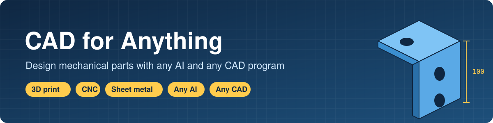
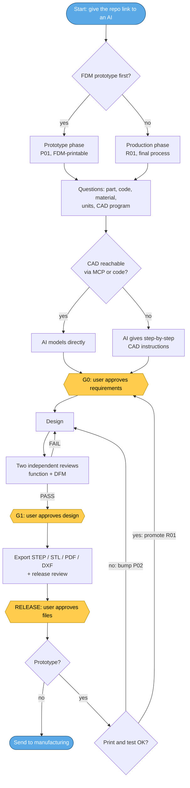
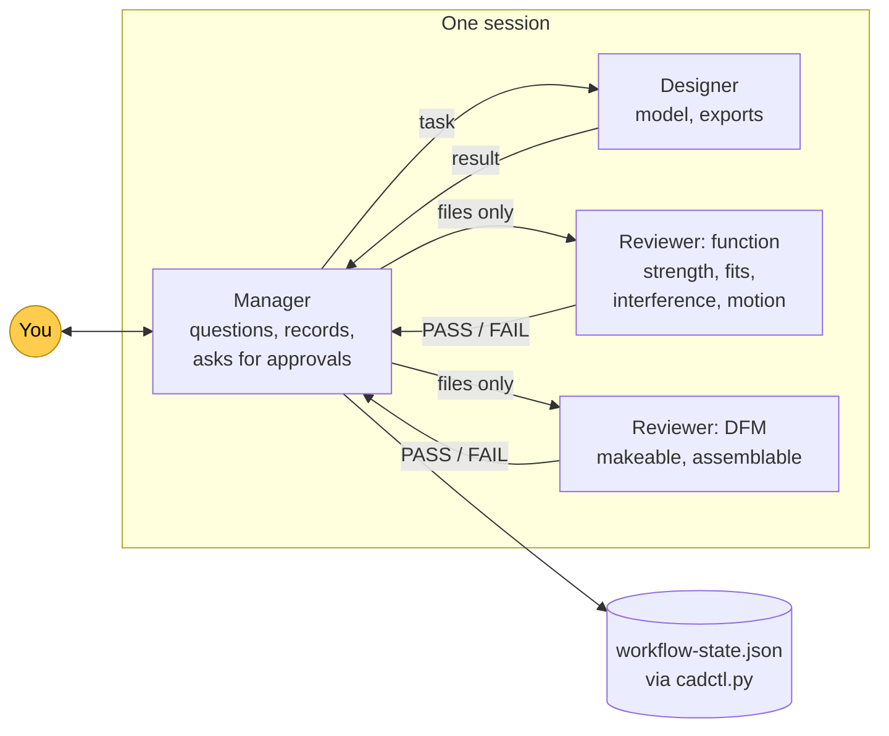
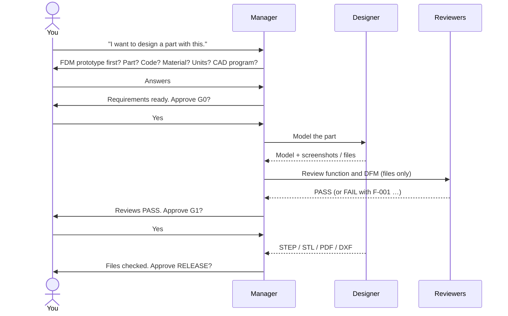
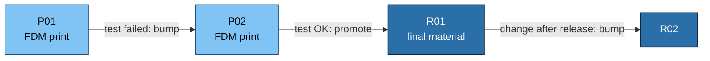
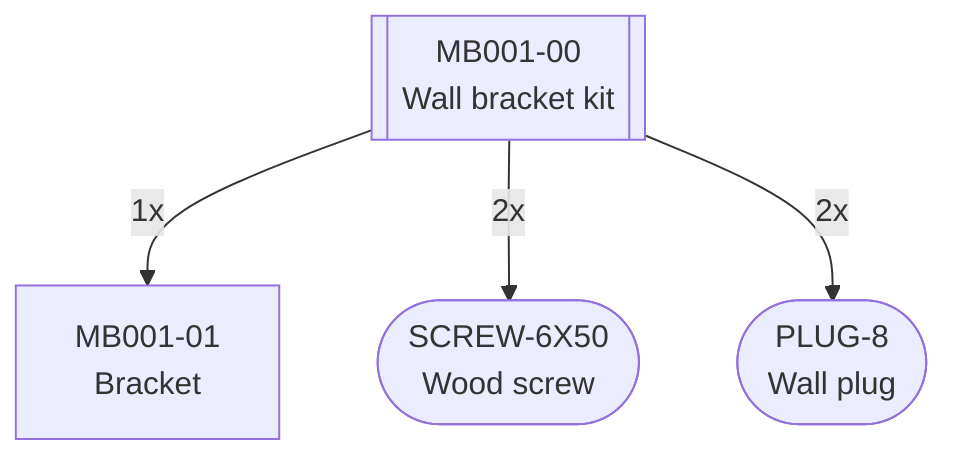

<p align="center">
  
</p>

<p align="center">
  <b>English</b> · <a href="README.tr.md">Türkçe</a>
</p>

<p align="center">
  <a href="https://github.com/d0ukan/cad-for-anything/actions/workflows/ci.yml"></a>
  
  <a href="LICENSE"></a>
  
  
  <a href="CHANGELOG.md"></a>
</p>

A small template for designing mechanical parts and assemblies — 3D printing,
CNC and sheet metal — together with **any AI assistant** and **any CAD program**
(FreeCAD, Fusion, Inventor, SolidWorks, CATIA, Onshape, CadQuery …).

| 💬 Ask | 📐 Design | 🔍 Review | 📦 Release |
| :---: | :---: | :---: | :---: |
| The AI asks short questions in order and writes the requirements | You (or the AI through MCP / code) build the model | Two reviewers check function and manufacturing | Named, checked and locked files for the workshop |

## 🚀 Quick start

1. Click **Use this template** to make your own copy.
2. Give the repo link to any AI chat and say:
   *"I want to design a part with this."*
3. The AI reads [AGENTS.md](AGENTS.md), asks a few questions in order, and
   guides you step by step. You build the model in your CAD program.

## ⚙️ How it works

- 🖨️ **Optional FDM prototype first.** The first question is: *print and test an
  FDM prototype first?* If yes, the part is designed to be printable
  (`P01`, `P02` …). When the print works, the project moves to the real
  material and process (`R01`).
- 👥 **Roles:** Manager (questions, records), Designer (model, exports) and
  two independent reviewers — **function** (strength, fits, interference,
  motion clearance) and **DFM** (can it be made and assembled).
  Everything runs in **one session**; the AI may use sub-agents inside it,
  but never opens a new chat by itself. See [ROLES.md](ROLES.md).
- 🚦 **Three gates, all approved by you:** G0 requirements → G1 design →
  RELEASE manufacturing files.
- 📏 **Short rules with IDs** in [rules/](rules/README.md): material (MAT),
  tolerances (TOL), DFM, drawings (DWG), naming (REV).
- 🌳 **Parts list / product tree:** `project/bom.csv`, checked and drawn by
  `cadctl.py bom` (see the [example](examples/MB001-wall-bracket/README.md)).
- 🔒 **Released files are locked:** hashes are stored at RELEASE; any later
  change is reported and needs a new revision.

### 🗺️ Workflow



### 👥 One session, many roles

The whole project stays in **one chat/session**. The Manager talks to you;
Designer and reviewer work can go to sub-agents inside the same session
(`ROL-09`). Without sub-agents the AI plays the roles one after another.



### 💬 What a session looks like



### 🔁 Revisions: prototype → production



## 🛠️ The helper tool

No dependencies, Python 3.10+.

```
python scripts/cadctl.py next      # what to do now, who does it, which command
python scripts/cadctl.py status    # project state
python scripts/cadctl.py check     # release files present and named right?
python scripts/cadctl.py bom       # product tree from project/bom.csv (--mermaid for a diagram)
```

Other commands: `set`, `approve`, `review`, `block`, `unblock`, `bump`,
`promote`, `name`. Run `python scripts/cadctl.py -h`.

Example output (from the [MB001 example](examples/MB001-wall-bracket/README.md)):

```
$ python scripts/cadctl.py next
Next (User): Approve design (G1) for R01
  python scripts/cadctl.py approve G1 --evidence "<where the user approved>"

$ python scripts/cadctl.py bom
MB001-00  Wall bracket kit  [assembly]
|-- 1 x MB001-01  Bracket  [make: S235 steel, 2 mm, zinc plated, sheet-metal]
|-- 2 x SCREW-6X50  Wood screw  [buy: 6 x 50 mm, pan head, zinc]
`-- 2 x PLUG-8  Wall plug  [buy: 8 mm nylon]
```

The same tree with `bom --mermaid`:



## 🔌 CAD access (optional)

After you name your CAD program, the AI checks whether it can reach it
through an MCP server. If not, it shows you known MCP servers for your program
and asks whether to set one up or continue with step-by-step instructions.
List and details: [AGENTS.md, section 5](AGENTS.md#5-cad-access-check-after-question-6).

| CAD program | How the AI works with it |
| :--- | :--- |
| Fusion · Inventor · SolidWorks · CATIA · Onshape · FreeCAD | 🔌 MCP server if connected, otherwise 📝 step-by-step instructions |
| CadQuery (code) | 🐍 The AI writes and runs a script in `project/cad/` |
| Anything else | 📝 Step-by-step instructions; you send screenshots or files back |

## 📁 Files

| Path | What |
| :--- | :--- |
| `AGENTS.md` | Instructions for the AI: what to read, what to ask |
| `ROLES.md` | Roles, gates, prototype → production flow |
| `rules/` | Rule files |
| `project/` | Your project: `requirements.md`, `workflow-state.json`, `bom.csv`, `cad/` (optional model scripts), `release/` |
| `examples/MB001-wall-bracket/` | Filled example |
| `scripts/cadctl.py` | State, next step, gate checks |
| `assets/` | Images for the README |

## 🤝 Contributing

See [CONTRIBUTING.md](CONTRIBUTING.md). Update both `README.md` and
`README.tr.md` when you change the README.
