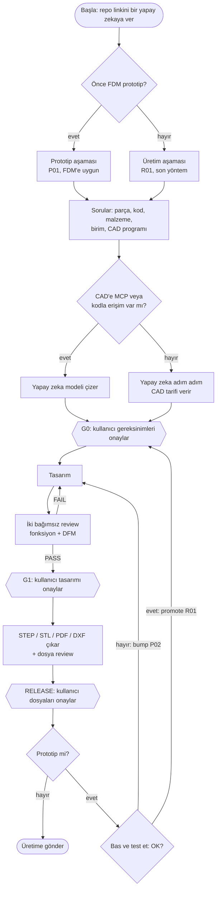

# CAD for Anything

[English](README.md) · **Türkçe**

[](https://github.com/d0ukan/cad-for-anything/actions/workflows/ci.yml) · Lisans: [MIT](LICENSE) · Sürüm: v0.3.0 ([değişiklikler](CHANGELOG.md))

Mekanik parça ve montaj tasarımı (3D baskı, CNC, sac metal) için küçük bir
şablon. **Herhangi bir yapay zeka** ve **herhangi bir CAD programı** ile
çalışır (FreeCAD, Fusion, SolidWorks, Onshape, CadQuery …).

Kural dosyaları İngilizcedir; yapay zeka sizinle Türkçe konuşabilir.

## Hızlı başlangıç

1. **Use this template** ile kendi kopyanızı oluşturun.
2. Repo linkini herhangi bir yapay zeka sohbetine verin ve
   *"Bununla bir parça tasarlamak istiyorum"* deyin.
3. Yapay zeka [AGENTS.md](AGENTS.md) dosyasını okur, soruları sırayla sorar
   ve adım adım yol gösterir. Modeli siz CAD programında çizersiniz.

## Nasıl çalışır

- **İsteğe bağlı önce FDM prototip.** İlk soru: *önce FDM prototip basıp
  test edecek misiniz?* Evet ise parça baskıya uygun tasarlanır
  (`P01`, `P02` …). Baskı işe yarayınca proje gerçek malzeme ve yönteme
  geçer (`R01`).
- **Roller:** Manager (sorular, kayıtlar), Designer (model, çıktılar) ve
  iki bağımsız reviewer — **fonksiyon** (dayanım, geçmeler) ve **DFM**
  (üretilebilir mi). Bkz. [ROLES.md](ROLES.md).
- **Üç kapı, hepsini siz onaylarsınız:** G0 gereksinimler → G1 tasarım →
  RELEASE üretim dosyaları.
- **Kimlikli kısa kurallar** [rules/](rules/README.md) altında: malzeme (MAT),
  tolerans (TOL), DFM, çizim (DWG), adlandırma (REV).

### İş akışı



## Yardımcı araç

Bağımlılık yok, Python 3.10+.

```
python scripts/cadctl.py next      # şimdi ne yapılacak, kim yapacak, hangi komut
python scripts/cadctl.py status    # proje durumu
python scripts/cadctl.py check     # üretim dosyaları var ve doğru adlı mı?
```

Diğer komutlar: `set`, `approve`, `review`, `block`, `unblock`, `bump`,
`promote`, `name`. Ayrıntı: `python scripts/cadctl.py -h`.

## CAD erişimi (isteğe bağlı)

CAD programınızı söyledikten sonra yapay zeka ona bir MCP sunucusu üzerinden
erişip erişemediğini kontrol eder. Erişemiyorsa programınız için bilinen MCP
sunucularını gösterir (Fusion, Inventor, SolidWorks, CATIA, Onshape, FreeCAD)
ve kurmak mı yoksa adım adım tarifle devam etmek mi istediğinizi sorar.
Liste ve ayrıntılar: [AGENTS.md, bölüm 5](AGENTS.md#5-cad-access-check-after-question-6).

## Dosyalar

| Yol | Ne |
| :--- | :--- |
| `AGENTS.md` | Yapay zeka için talimat: ne okur, ne sorar |
| `ROLES.md` | Roller, kapılar, prototip → üretim akışı |
| `rules/` | Kural dosyaları |
| `project/` | Sizin projeniz: `requirements.md`, `workflow-state.json`, `cad/` (isteğe bağlı model betikleri), `release/` |
| `examples/MB001-wall-bracket/` | Doldurulmuş örnek |
| `scripts/cadctl.py` | Durum, sıradaki adım, kapı kontrolü |

## Katkı

Bkz. [CONTRIBUTING.md](CONTRIBUTING.md). README değişince hem `README.md`
hem `README.tr.md` güncellenir.
