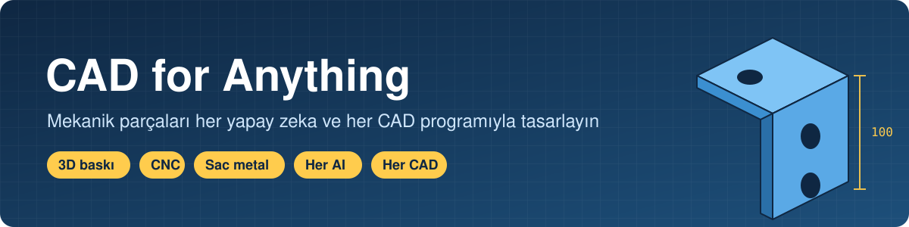
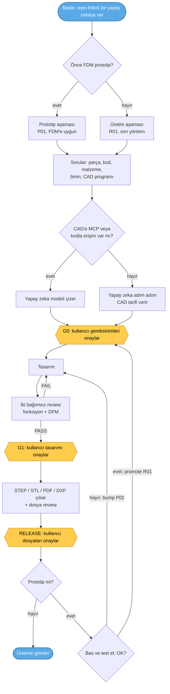
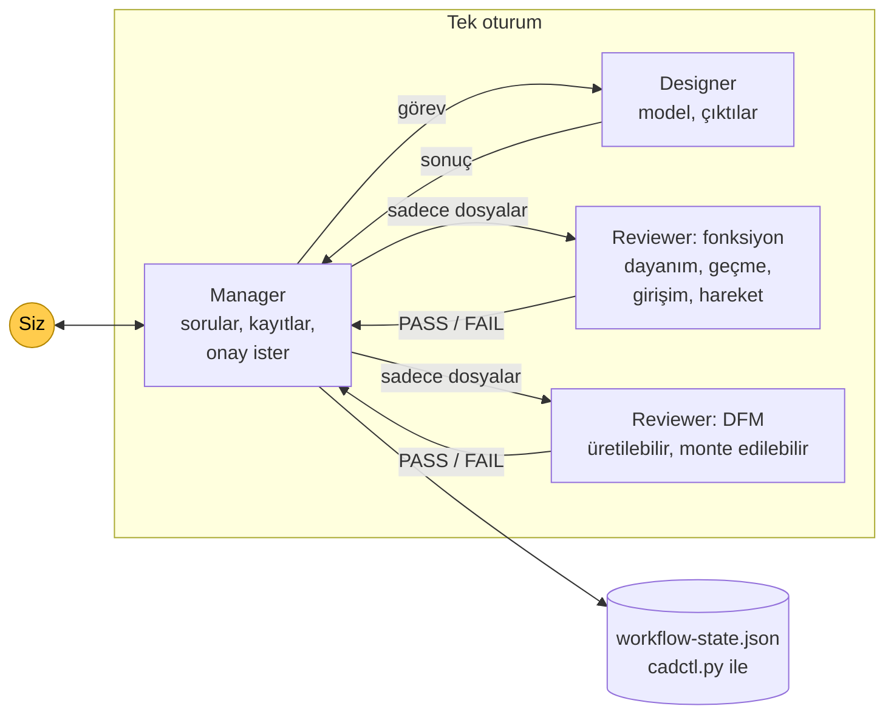
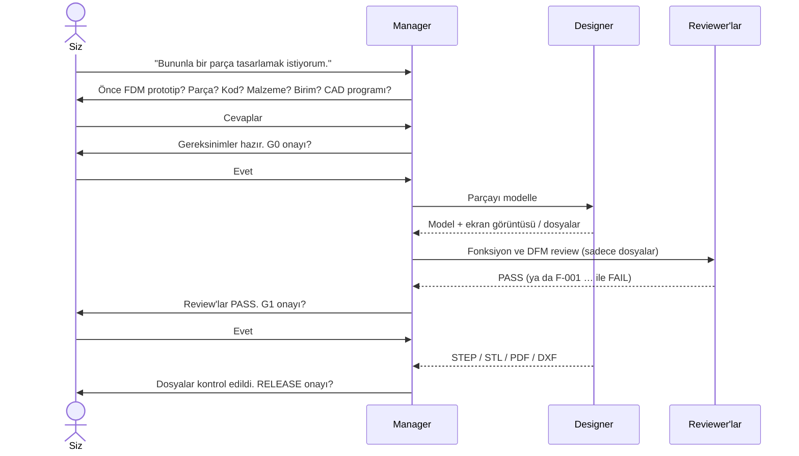
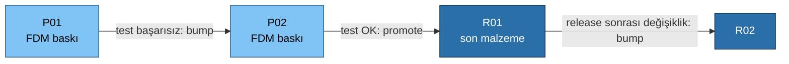
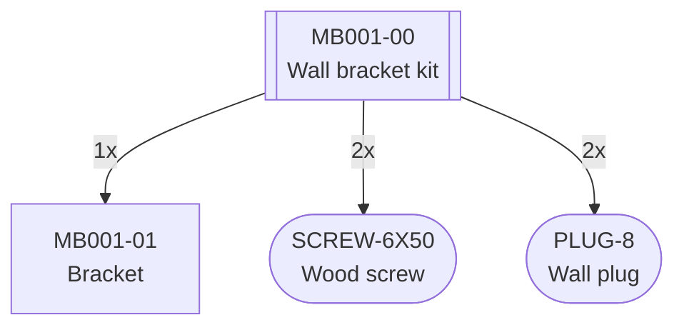

<p align="center">
  
</p>

<p align="center">
  <a href="README.md">English</a> · <b>Türkçe</b>
</p>

<p align="center">
  <a href="https://github.com/d0ukan/cad-for-anything/actions/workflows/ci.yml"></a>
  
  <a href="LICENSE"></a>
  
  
  
  <a href="CHANGELOG.md"></a>
</p>

Mekanik parça ve montaj tasarımı (3D baskı, CNC, sac metal) için küçük bir
şablon. **Herhangi bir yapay zeka** ve **herhangi bir CAD programı** ile
çalışır (FreeCAD, Fusion, Inventor, SolidWorks, CATIA, Onshape, CadQuery,
OpenSCAD …). **Windows, macOS ve Linux**'ta kullanılır.

Kural dosyaları İngilizcedir; yapay zeka sizinle Türkçe konuşabilir.

| 💬 Sor | 📐 Tasarla | 🔍 Kontrol | 📦 Teslim |
| :---: | :---: | :---: | :---: |
| Yapay zeka kısa soruları sırayla sorar, gereksinimleri yazar | Modeli siz (ya da MCP / kodla yapay zeka) çizer | İki reviewer fonksiyonu ve üretimi kontrol eder | Atölye için adlı, kontrollü ve kilitli dosyalar |

## 🚀 Hızlı başlangıç

1. **Use this template** ile kendi kopyanızı oluşturun.
2. Repo linkini herhangi bir yapay zeka sohbetine verin ve
   *"Bununla bir parça tasarlamak istiyorum"* deyin.
3. Yapay zeka [AGENTS.md](AGENTS.md) dosyasını okur, soruları sırayla sorar
   ve adım adım yol gösterir. Modeli siz CAD programında çizersiniz.

## ⚙️ Nasıl çalışır

- 🖨️ **İsteğe bağlı önce FDM prototip.** İlk soru: *önce FDM prototip basıp
  test edecek misiniz?* Evet ise parça baskıya uygun tasarlanır
  (`P01`, `P02` …). Baskı işe yarayınca proje gerçek malzeme ve yönteme
  geçer (`R01`).
- 👥 **Roller:** Manager (sorular, kayıtlar), Designer (model, çıktılar) ve
  iki bağımsız reviewer — **fonksiyon** (dayanım, geçmeler, girişim,
  hareket boşluğu) ve **DFM** (üretilebilir ve monte edilebilir mi).
  Her şey **tek oturumda** yürür; yapay zeka içinde alt ajan kullanabilir,
  ama kendi başına yeni sohbet açmaz. Bkz. [ROLES.md](ROLES.md).
- 🚦 **Üç kapı, hepsini siz onaylarsınız:** G0 gereksinimler → G1 tasarım →
  RELEASE üretim dosyaları.
- 📏 **Kimlikli kısa kurallar** [rules/](rules/README.md) altında: malzeme (MAT),
  tolerans (TOL), DFM, çizim (DWG), adlandırma (REV).
- 🌳 **Parça listesi / ürün ağacı:** `project/bom.csv`; `cadctl.py bom` kontrol
  eder ve ağacı çizer (bkz. [örnek](examples/MB001-wall-bracket/README.md)).
- 🔒 **Onaylanan dosyalar kilitli:** RELEASE anında dosya özetleri (hash)
  saklanır; sonradan değişiklik yakalanır ve yeni revizyon gerekir.

### 🗺️ İş akışı



### 👥 Tek oturum, çok rol

Bütün proje **tek sohbette/oturumda** kalır. Sizinle Manager konuşur;
Designer ve reviewer işleri aynı oturumun içindeki alt ajanlara verilebilir
(`ROL-09`). Alt ajan yoksa yapay zeka rolleri sırayla kendisi oynar.



### 💬 Bir oturum nasıl geçer



### 🔁 Revizyonlar: prototip → üretim



## 🛠️ Yardımcı araç

Bağımlılık yok, Python 3.10+. Windows, macOS ve Linux'ta test edilir.

```
python scripts/cadctl.py next      # şimdi ne yapılacak, kim yapacak, hangi komut
python scripts/cadctl.py status    # proje durumu
python scripts/cadctl.py check     # üretim dosyaları var ve doğru adlı mı?
python scripts/cadctl.py bom       # project/bom.csv'den ürün ağacı (--mermaid ile şema)
```

Diğer komutlar: `set`, `approve`, `review`, `block`, `unblock`, `bump`,
`promote`, `name`. Ayrıntı: `python scripts/cadctl.py -h`.

Örnek çıktı ([MB001 örneğinden](examples/MB001-wall-bracket/README.md);
aracın çıktısı İngilizcedir):

```
$ python scripts/cadctl.py next
Next (User): Approve design (G1) for R01
  python scripts/cadctl.py approve G1 --evidence "<where the user approved>"

$ python scripts/cadctl.py bom
MB001-00  Wall bracket kit  [assembly]
|-- 1 x MB001-01  Bracket  [make: S235 steel, 2 mm, zinc plated, sheet-metal]
|-- 2 x SCREW-6X50  Wood screw  [buy: 6 x 50 mm, pan head, zinc]
`-- 2 x PLUG-8  Wall plug  [buy: 8 mm nylon]
```

Aynı ağaç `bom --mermaid` ile:



## 🔌 CAD erişimi (isteğe bağlı)

CAD programınızı söyledikten sonra yapay zeka ona bir MCP sunucusu üzerinden
erişip erişemediğini kontrol eder. Erişemiyorsa programınız için bilinen MCP
sunucularını gösterir ve kurmak mı yoksa adım adım tarifle devam etmek mi
istediğinizi sorar.
Liste ve ayrıntılar: [AGENTS.md, bölüm 5](AGENTS.md#5-cad-access-check-after-question-6).

| CAD programı | Yapay zeka nasıl çalışır |
| :--- | :--- |
| Fusion · Inventor · SolidWorks · CATIA · Onshape · FreeCAD | 🔌 Bağlıysa MCP sunucusu, değilse 📝 adım adım tarif |
| CadQuery · OpenSCAD (kod) | 🐍 Yapay zeka `project/cad/` içine betik yazar ve çalıştırır (örnek: [`.py`](examples/MB001-wall-bracket/cad/mb001_bracket.py), [`.scad`](examples/MB001-wall-bracket/cad/mb001_bracket.scad)) |
| Diğerleri | 📝 Adım adım tarif; siz ekran görüntüsü veya dosya gönderirsiniz |

## 📁 Dosyalar

| Yol | Ne |
| :--- | :--- |
| `AGENTS.md` | Yapay zeka için talimat: ne okur, ne sorar |
| `ROLES.md` | Roller, kapılar, prototip → üretim akışı |
| `rules/` | Kural dosyaları |
| `project/` | Sizin projeniz: `requirements.md`, `workflow-state.json`, `bom.csv`, `cad/` (isteğe bağlı model betikleri), `release/` |
| `examples/MB001-wall-bracket/` | Doldurulmuş örnek |
| `scripts/cadctl.py` | Durum, sıradaki adım, kapı kontrolü |
| `assets/` | README görselleri |

## 🤝 Katkı

Bkz. [CONTRIBUTING.md](CONTRIBUTING.md). README değişince hem `README.md`
hem `README.tr.md` güncellenir.
