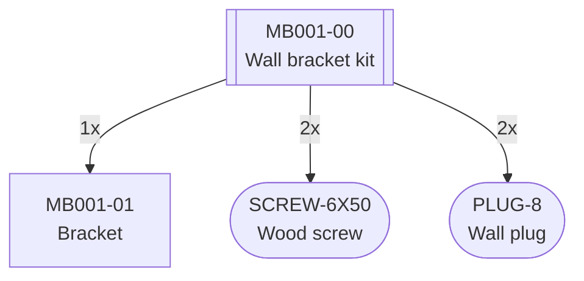

# Example: MB001 wall bracket

A shelf bracket that went through two FDM prototypes and then moved to
2 mm laser-cut, bent sheet steel.

| File | What it shows |
| :--- | :--- |
| [requirements.md](requirements.md) | Filled requirements, revision history P01 → P02 → R01 |
| [review.md](review.md) | Function and DFM reviewer findings in `F-001` format with rule IDs |
| [workflow-state.json](workflow-state.json) | State: production R01, G0 and both design reviews done, G1 waiting |
| [bom.csv](bom.csv) | Parts list / product tree |
| [cad/mb001_bracket.py](cad/mb001_bracket.py) | Simplified CadQuery model of R01 (optional; needs `pip install cadquery`; writes STEP) |
| [cad/mb001_bracket.scad](cad/mb001_bracket.scad) | The same model in OpenSCAD (optional; `openscad -o MB001-R01.stl mb001_bracket.scad`) |
| [cad/mb001_bracket.js](cad/mb001_bracket.js) | The same model in JSCAD / JavaScript (optional; Node.js 18+: `npm install`, `npm run build`; writes STL) |

Product tree (`cadctl.py bom --mermaid`):



Try it:

```
python scripts/cadctl.py --state examples/MB001-wall-bracket/workflow-state.json status
python scripts/cadctl.py --state examples/MB001-wall-bracket/workflow-state.json next
python scripts/cadctl.py --state examples/MB001-wall-bracket/workflow-state.json bom
```
